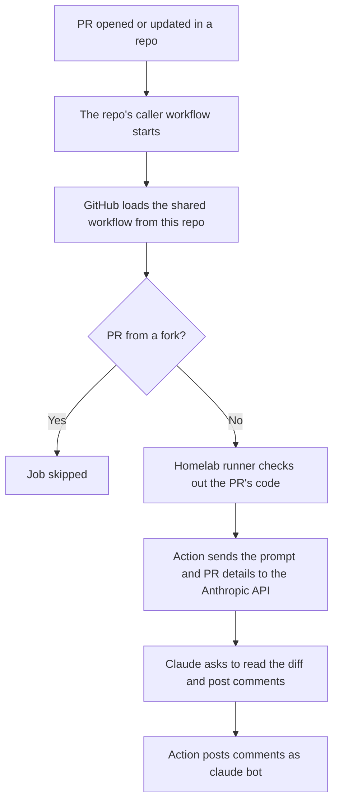

# ci

Shared GitHub Actions workflows for the `space0w1-labs` org. Jobs run on the org's self-hosted homelab runner.

| Workflow | Purpose |
|---|---|
| [`claude-review.yml`](.github/workflows/claude-review.yml) | Reviews pull requests with Claude and posts comments on them |

This repo holds the review logic, but a PR can only start workflows from its own repo. So each reviewed repo keeps a small caller workflow that points here.

## How a review runs



The action runs on the runner, but the model runs on Anthropic's servers, so the VM doesn't need a GPU. PR code is sent to Anthropic.

## What each piece does

| Piece | Purpose |
|---|---|
| Self-hosted runner | The machine that runs the action. Its own credentials only cover picking up jobs and reporting results |
| Claude GitHub App | The identity and permissions the action uses on GitHub, such as posting comments |
| `ANTHROPIC_API_KEY` | Authorises and pays for calls to Claude. It means nothing to GitHub |
| Caller workflow | Starts a review when a PR opens or updates, and grants the job its permissions |
| Shared workflow | Holds the review steps, prompt and allowed tools |

To post a comment, the action uses `id-token: write` to prove which repo and workflow it's running for, and exchanges that proof for a short-lived token tied to the app.

## Org setup

Do this once:

1. Install the [Claude GitHub App](https://github.com/apps/claude) on `space0w1-labs`, and select the repos to review.
2. Add `ANTHROPIC_API_KEY` under **Org Settings → Secrets and variables → Actions**, with access to those repos.
3. Under **Org Settings → Actions → General**, allow `anthropics/claude-code-action` and reusable workflows from this org.

## Add a repo

Add `.github/workflows/claude-review.yml` to the repo:

```yaml
name: Claude review

on:
  pull_request:
    types: [opened, synchronize, reopened]

jobs:
  review:
    permissions:
      contents: read
      pull-requests: write
      id-token: write
    uses: space0w1-labs/ci/.github/workflows/claude-review.yml@main
    secrets: inherit
```

Then open a PR. The `Claude review` check should run on `github-runner`, and comments appear if the review finds anything.

`secrets: inherit` only works when this repo and the calling repo are in the same org. This repo must stay public, because public repos can't call reusable workflows in a private repo.

## Changing the review

Edit the prompt or `--allowedTools` in [`claude-review.yml`](.github/workflows/claude-review.yml). Callers use `@main`, so every repo picks up the change on its next PR.

## Security

- **Limit who can push here.** Workflows in this repo run on the homelab runner with access to the API key.
- **Never store secrets in this repo.** It's public, and the workflow only refers to the key by name.
- **Skip fork PRs.** They don't receive secrets, and the check keeps outside code off the runner. Don't use `pull_request_target` to get around this.
- **Keep the tool list narrow.** PR content can contain instructions aimed at the AI (prompt injection), so the action can only read the PR and post comments.
- **Treat reviews as advice.** Don't let a review approve or merge anything, or make one a condition for merging.

## Cost

Each review uses paid API credits. `synchronize` runs a review on every push to a PR, so remove it from the caller if that gets too expensive.
