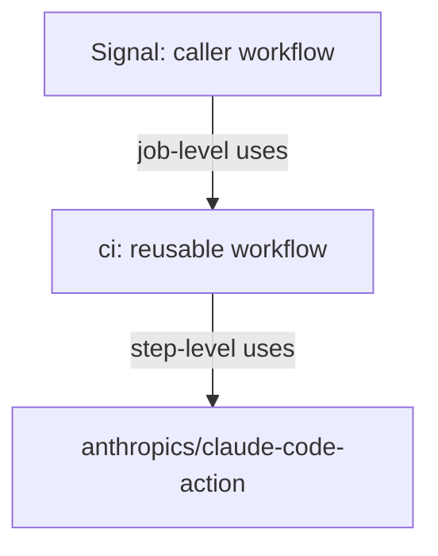
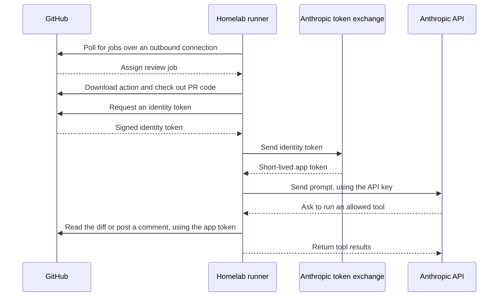

# Concepts

How the shared Claude review works, and why each part is needed. For setup steps, see the [README](../README.md).

## The parts

| Part | What it is | Where it lives |
|---|---|---|
| Caller workflow | A small file that starts a review for one repo | Each reviewed repo |
| Reusable workflow | The review steps, prompt and allowed tools | This repo |
| `claude-code-action` | Anthropic's action, which runs Claude Code in a job | `anthropics/claude-code-action`, downloaded for each job |
| Self-hosted runner | The VM that runs the job | Homelab, Proxmox |
| Claude GitHub App | The identity used on GitHub | Installed on the org, for selected repos |
| `ANTHROPIC_API_KEY` | Authorises and pays for calls to Claude | Org Actions secret |

## Caller and reusable workflows

GitHub only looks in the repo where a PR was opened to decide what to run, and only in that repo's `.github/workflows/` folder. Subfolders aren't supported, and a YAML file anywhere else is ignored without an error.

So each repo needs its own caller, even though the logic is here. The chain of `uses:` references looks like this:

| `uses:` level | Calls | Example |
|---|---|---|
| Job | A whole reusable workflow | `space0w1-labs/ci/.github/workflows/claude-review.yml@main` |
| Step | One action, as part of a job | `anthropics/claude-code-action@v1` |

The steps come from this repo, but the job runs on behalf of the caller. `actions/checkout` gets the calling repo's code, and `github.repository` is the calling repo's name.

Two rules limit where this repo can live:

- **It must be public.** Public repos can't call a reusable workflow in a private repo.
- **It must be in the same org as its callers.** `secrets: inherit` only works within an org or enterprise.

## Where the work happens

- **The action runs on the runner.** It sets up, gets the token and runs the tools.
- **Claude runs on Anthropic's servers.** It decides what to read and writes the review, so the VM doesn't need a GPU. PR code is sent to Anthropic.
- **Nothing connects into the homelab.** The runner makes every connection outbound.
- **Comments only appear when there's something to say.** The prompt says to comment only on real issues, so a green check with no comments is normal for a small change.

## Three credentials

| Credential | Used with | Purpose |
|---|---|---|
| Runner credentials | GitHub | Pick up jobs and report results. They can't comment on PRs |
| App token | GitHub | Read the PR and post comments as `claude[bot]` |
| `ANTHROPIC_API_KEY` | Anthropic | Authorise and pay for Claude. It means nothing to GitHub |

## The GitHub App

A GitHub App is a limited identity on GitHub, with its own name, permissions and list of repos. It isn't a proxy, and it doesn't run anything: the workflow calls the action, and the app only supplies the identity behind its GitHub requests.

The app needs access to the repos **being reviewed**, not this repo, because comments are posted on their PRs.

The YAML doesn't mention the app. When `github_token` isn't set, the action gets a token by itself:

1. The caller grants `id-token: write`, which lets the job request a signed identity token from GitHub.
2. The action sends that token to Anthropic's exchange.
3. The exchange checks the signature and that the app is installed on the repo, then returns a short-lived app token.

A repo's other jobs aren't connected to the app. A job only gets an app token if it has `id-token: write` and a step requests one, so grant that permission only on the review job.

### Other ways to get a token

| Option | Comments appear as | Trade-off |
|---|---|---|
| Claude GitHub App | `claude[bot]` | The standard setup; relies on Anthropic's exchange |
| `GITHUB_TOKEN` | `github-actions[bot]` | No app to install, but a less clear identity |
| Your own GitHub App | Your app's name | Your choice of name, but you look after a private key |

The last two pass a token through the action's `github_token` input, which skips the exchange. Neither has been tested with this workflow.

## Runner requirements

GitHub's hosted runners come with many tools, but a self-hosted runner only has what's installed on it. This workflow needs:

| Tool | Used for |
|---|---|
| `unzip` | The action's Bun install |
| `gh` | The `gh pr` commands in the allowed tools |
| `git` | Checking out the PR's code |

These are installed by cloud-init in `homelab-infrastructure`, at `terraform/github-runner/cloud-init.yaml.tftpl`. Changing that file makes the next `terraform apply` rebuild the runner VM.

## Why fork PRs are skipped

The repos are public, so anyone can open a PR from a fork, and a job on the runner would run on the homelab. The workflow's `if` condition skips those PRs, and they wouldn't receive secrets or `id-token: write` under `pull_request` anyway.

Don't use `pull_request_target` to get around this. It runs with the repo's secrets and write access, which is dangerous if it touches PR code.

## The first PR in a repo

The action checks the workflow against the version on the repo's default branch. So the PR that adds the caller may fail with a validation error, even when everything is set up correctly.

Merge that PR, then open a second PR to test the review.
